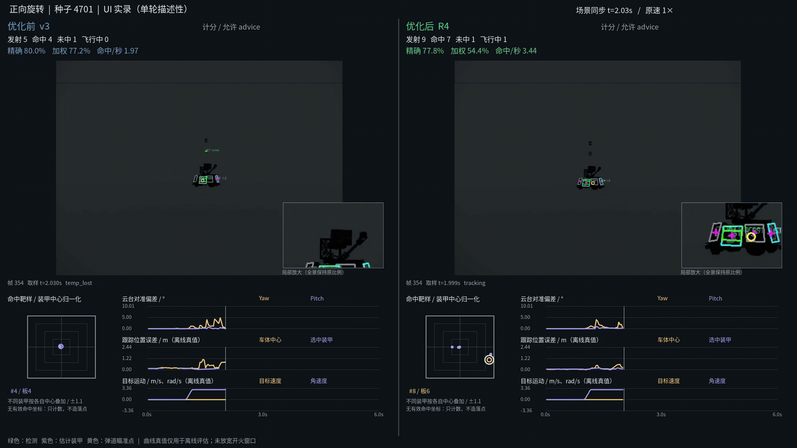
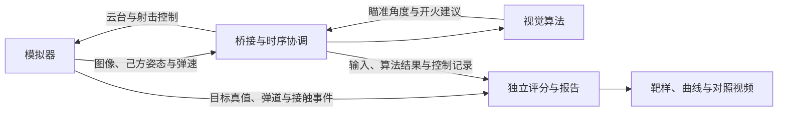

<div align="center">


# APERTURE Vision 26

**面向 RoboMaster 的视觉算法开发与仿真验证系统**

装甲板识别 · 目标跟踪 · 运动预测 · 自动瞄准 · 闭环仿真

   

[快速开始](#快速开始) · [效果展示](#效果展示) · [系统架构](#系统架构) · [开发文档](#开发文档)

</div>

APERTURE Vision 26 围绕装甲板目标的检测、状态估计、运动预测与开火决策，连接独立视觉算法和模拟器，提供从图像输入到射击评估的完整开发流程。通过固定条件的批量实验和可视化复核，支持算法迭代、问题诊断与后续实车适配。

目前以仿真开发和验证为主，实车标定与部署持续推进。

## 项目特色

- **独立的视觉算法**：复用 C++ 自瞄框架，支持装甲板检测、位姿解算、目标跟踪、弹道预测和开火建议；核心仿真适配入口无 ROS 依赖。
- **完整的仿真闭环**：模拟器提供图像、己方姿态和弹速，接收云台与射击指令，记录弹丸轨迹和实际接触事件。
- **可选难度的运动场景**：覆盖平移、旋转、变速、频繁变向、移动中旋转启停与己方追击，按实际运动记录核对测试强度。
- **可重复的后台实验**：冻结源码、配置、二进制和镜像版本，支持任务队列、非实时同步步进、受条件约束的并行运行和中断恢复。
- **逐发评分与视觉验收**：同时记录精确命中率、中心加权命中率和落点分布，导出包含靶样、控制曲线的前后对照视频。

## 效果展示

### 旋转目标跟踪与射击对照

[](docs/DEMO.md)

*左侧 v3，右侧 R4 研究候选。节选自保存的 UI 仿真实录，保留命中计数、装甲靶样与同步参数曲线；它展示实验审查方式，单段视频不代表全场景或实车性能。*

查看[演示说明与素材来源](docs/DEMO.md)。

## 系统架构



算法只读取视觉观测和己方状态；目标真值用于独立评估。算法与模拟器均可独立维护，主仓库负责接入、实验和验收。

## 快速开始

### 1. 获取项目

```bash
git clone --recurse-submodules https://github.com/Kunlun-APERTURE/APERTURE_vision_26.git
cd APERTURE_vision_26
python3 tools/check-workspace.py
```

已有主仓库可执行 `git submodule update --init --recursive`，取得主仓库指定的源码版本。

### 2. 准备环境

|模块|主要环境|
|---|---|
|视觉算法|C++17、OpenCV、Eigen、OpenVINO|
|模拟器|Rust、Bevy、ROS 2 Jazzy；集成构建启用 `ros2 bench`|
|实验平台|Python 3、Docker Compose / Buildx、NVIDIA GPU 与容器支持|
|当前 UI 部署|Sunshine 桌面与显示会话|

首次使用请按[部署说明](docs/DEPLOYMENT.md)准备依赖环境和镜像。当前启动脚本对接已有工作站，克隆源码后还需完成环境配置。

### 3. 运行与检查

在已配置的工作站上：

```bash
./sim.sh status
./sim.sh start --scene static --control off --fire off
./sim.sh control on
./sim.sh stop
```

启动默认关闭控制和开火；上述示例只开启跟踪控制。后台射击实验的完整命令见[实验操作](docker/auto_aim/README.md)，也可以先查看可选场景：

```bash
./sim.sh experiment suite --tier advanced --cases variable,turn04 --list
```

构建与组件测试见[可用性自检](docs/CHECKS.md)。

## 项目结构

```text
APERTURE_vision_26/
├── sp_vision_25/           # 视觉算法 submodule
├── vision_simulator_26/    # 模拟器 submodule
├── docker/
│   ├── auto_aim/           # 桥接、实验调度、评分与视频工具
│   └── daedalus/           # 独立模拟器部署
├── docs/                  # 环境、接口、开发与验收文档
├── tools/                 # 工作区检查与组件测试配置
├── release/               # 阶段版本与精简验收证据
├── RM26.code-workspace    # VSCode 多仓库工作区
└── sim.sh                 # 联调与实验统一入口
```

|仓库|职责|
|---|---|
|[APERTURE_vision_26](https://github.com/Kunlun-APERTURE/APERTURE_vision_26)|部署、桥接、实验组织与验收|
|[sp_vision_25](https://github.com/angjustinl/sp_vision_25)|视觉估计、运动预测、瞄准与火控|
|[vision_simulator_26](https://github.com/ANGJustinl/vision_simulator_26)|场景、成像、车辆/云台、弹丸和事件接口|

两个 submodule 保留各自历史和构建方式，主仓库记录经选择的提交版本。更新及提交顺序见[协作指南](docs/SUBMODULES.md)。

## 开发方向

- 完善高速移动、旋转和变向工况下的估计与预测。
- 核对枪口瞬时速度、旋转装甲接触和物理步长收敛。
- 对齐云台响应、底盘运动、成像和通信时序的实测特征。
- 完善环境分发与实车适配，降低团队复现实验的成本。

当前能力、模型假设及待解决问题集中记录在[阶段状态](docs/STATUS.md)。

## 开发文档

|主题|文档|
|---|---|
|环境与部署|[部署说明](docs/DEPLOYMENT.md)|
|构建与自检|[可用性检查](docs/CHECKS.md)|
|仓库协作|[Submodule 指南](docs/SUBMODULES.md)|
|模块职责与数据流|[接口边界](docs/INTERFACES.md)|
|实验操作与后台队列|[运行入口](docker/auto_aim/README.md) · [任务与证据](docker/auto_aim/THROUGHPUT.md)|
|测试场景|[基础与进阶分档](docker/auto_aim/MOVEMENT_TIERS.md)|
|团队视觉审查|[视频验收](docker/auto_aim/REVIEW_VIDEO.md)|
|当前进度|[阶段状态](docs/STATUS.md)|

## 致谢与来源

视觉算法基于[同济大学 SuperPower 战队 sp_vision_25](https://github.com/TongjiSuperPower/sp_vision_25)继续开发；仿真部分基于[vision_simulator_26 / Daedalus](https://github.com/ANGJustinl/vision_simulator_26)。感谢相关开源项目及 OpenVINO、OpenCV、Eigen、Bevy、ROS 2 等工具生态的贡献者。

子仓库及第三方组件的许可分别见其 LICENSE 文件：[算法 MIT 许可](https://github.com/ANGJustinl/sp_vision_25/blob/d5d012d6b5d50b9ac80a041647a9d7ba410fd476/LICENSE)、[模拟器 AGPL-3.0 许可](https://github.com/ANGJustinl/vision_simulator_26/blob/778c0c8fba8022835eeabb3f81c4c865f588a34e/LICENSE)。仓库组合不替代各组件的原许可。

开发与协作：[团队本地开发](docs/DEVELOPMENT.md) · [审查触发的 PR 实验服务](docs/PR_EXPERIMENTS.md)。
