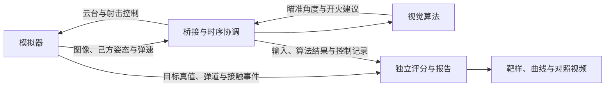

<div align="center">


# APERTURE Vision 26

**面向 RoboMaster 的视觉算法开发与仿真验证系统**

装甲板识别 · 目标跟踪 · 运动预测 · 自动瞄准 · 闭环仿真

   

[快速开始](#快速开始) · [效果展示](#效果展示) · [系统架构](#系统架构) · [开发文档](#使用与开发文档)

</div>

APERTURE Vision 26 围绕装甲板目标的检测、状态估计、运动预测与开火决策，连接独立视觉算法和模拟器，提供从图像输入到射击评估的完整开发流程。通过固定条件的批量实验和可视化复核，支持算法迭代、问题诊断与后续实车适配。

目前以仿真开发和验证为主，实车标定与部署持续推进。

## 项目特色

- **独立的视觉算法**：复用 C++ 自瞄框架，支持装甲板检测、位姿解算、目标跟踪、弹道预测和开火建议；核心仿真适配入口无 ROS 依赖。
- **完整的仿真闭环**：模拟器提供图像、己方姿态和弹速，接收云台与射击指令，记录弹丸轨迹和实际接触事件。
- **可选难度的运动场景**：覆盖平移、旋转、变速、频繁变向、移动中旋转启停与己方追击，按实际运动记录核对测试强度。
- **可重复的后台实验**：冻结源码、配置、二进制和镜像版本，支持任务队列、非实时同步步进、受条件约束的并行运行和中断恢复。
- **逐发评分与视觉验收**：同时记录精确命中率、中心加权命中率和落点分布，导出包含靶样、控制曲线的前后对照视频。

## 效果展示

### 旋转目标跟踪与射击对照

[](docs/DEMO.md)

*左侧 v3，右侧 R4 研究候选。节选自保存的 UI 仿真实录，保留命中计数、装甲靶样与同步参数曲线；它展示实验审查方式，单段视频不代表全场景或实车性能。*

查看[演示说明与素材来源](docs/DEMO.md)。

## 系统架构



算法只读取视觉观测和己方状态；目标真值用于独立评估。算法与模拟器均可独立维护，主仓库负责接入、实验和验收。

## 快速开始

支持 **Ubuntu 24.04 x86_64＋NVIDIA GPU＋Docker**，后台实验无需 Sunshine 或显示器。无 GPU 可运行自动测试。

请按 [新人快速开始](docs/QUICKSTART.md) 获取源码、导入依赖、构建并完成首轮实验。**依赖包由维护者从工作站分发，目前没有公开下载地址**，实际来源、所需文件及交付限制见快速开始。

本地验证后按 [贡献指南](CONTRIBUTING.md) 提交 PR，独立审查者批准后由工作站回传实验成绩和日志。

## 项目结构

```text
APERTURE_vision_26/
├── sp_vision_25/           # 视觉算法 submodule
├── vision_simulator_26/    # 模拟器 submodule
├── docker/
│   ├── auto_aim/           # 桥接、实验调度、评分与视频工具
│   └── daedalus/           # 独立模拟器部署
├── docs/                  # 环境、接口、开发与验收文档
├── tools/                 # 工作区检查与组件测试配置
├── release/               # 阶段版本与精简验收证据
├── RM26.code-workspace    # VSCode 多仓库工作区
└── sim.sh                 # 联调与实验统一入口
```

|仓库|职责|
|---|---|
|[APERTURE_vision_26](https://github.com/Kunlun-APERTURE/APERTURE_vision_26)|部署、桥接、实验组织与验收|
|[sp_vision_25](https://github.com/angjustinl/sp_vision_25)|视觉估计、运动预测、瞄准与火控|
|[vision_simulator_26](https://github.com/ANGJustinl/vision_simulator_26)|场景、成像、车辆/云台、弹丸和事件接口|

两个 submodule 保留各自历史和构建方式，主仓库记录经选择的提交版本。更新及提交顺序见[协作指南](docs/SUBMODULES.md)。

## 使用与开发文档

|任务|入口|
|---|---|
|安装并完成第一次实验|[新人快速开始](docs/QUICKSTART.md)|
|选择场景、查看分数、比较结果|[实验指南](docs/EXPERIMENTS.md)|
|改算法、加场景、运行测试|[开发指南](docs/DEVELOPMENT.md)|
|提交改动并申请 PR 实验|[贡献指南](CONTRIBUTING.md)|
|维护工作站与排查服务|[运维指南](docs/OPERATIONS.md)|
|查阅协议与仓库职责|[接口参考](docs/INTERFACES.md)|

## 使用边界

已有本地闭环、独立算法接入和真实 PR 批准→实验→回传→清理验证。完整空机器安装尚未验收，当前 PR 服务主要评估算法 submodule 改动。

车辆、云台、成像和时延尚未对当前实车完成标定。分数用于同环境算法对照，不代表实车命中率，详见 [实验指南](docs/EXPERIMENTS.md#结果的适用范围)。

## 致谢与来源

视觉算法基于[同济大学 SuperPower 战队 sp_vision_25](https://github.com/TongjiSuperPower/sp_vision_25)继续开发；仿真部分基于[vision_simulator_26 / Daedalus](https://github.com/ANGJustinl/vision_simulator_26)。感谢相关开源项目及 OpenVINO、OpenCV、Eigen、Bevy、ROS 2 等工具生态的贡献者。

子仓库及第三方组件的许可分别见其 LICENSE 文件：[算法 MIT 许可](https://github.com/ANGJustinl/sp_vision_25/blob/d5d012d6b5d50b9ac80a041647a9d7ba410fd476/LICENSE)、[模拟器 AGPL-3.0 许可](https://github.com/ANGJustinl/vision_simulator_26/blob/778c0c8fba8022835eeabb3f81c4c865f588a34e/LICENSE)。仓库组合不替代各组件的原许可。
