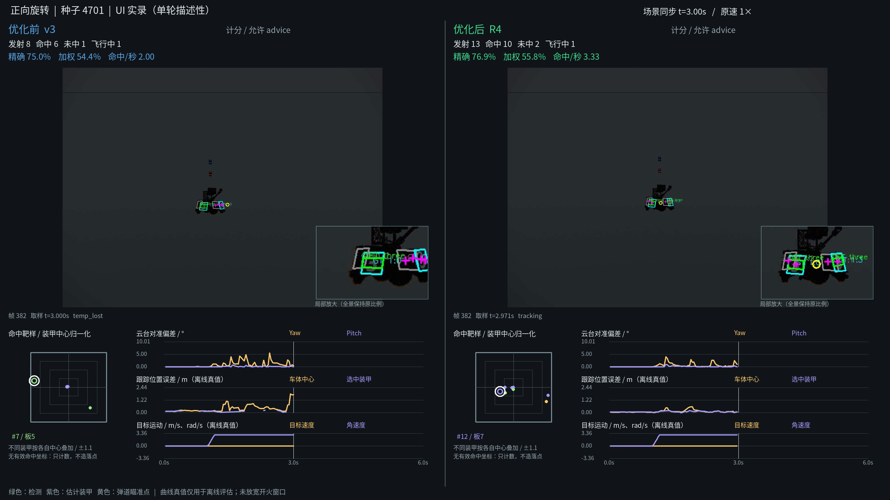

# 效果演示

## 旋转目标对照

首页的4秒动图来自2026-10-27保存的UI验收视频，截取正向旋转片段。左侧为v3，右侧为R4图像联合旋转研究候选；各侧同时显示输入图像、检测/瞄准、逐发计数、命中靶样及同步参数曲线。

这是冻结环境中的历史实验展示，使用当时的legacy云台模型；R4为研究候选，不由演示画面自动推广默认。单片段不替代多场景、多种子或实车验证。

- 片段：原视频24.533333–28.533333秒，对应场景相对时间约2–6秒。
- 预览：8 FPS、1280×720，由原片段降采样并缩小，保持左右画面与图表比例及原时间顺序，未修改图中数值。
- 静态图：同一配对的已归档审查帧。
- 完整材料：工作站“仿真实验报告/rotation-optimization-20261027-visual-review”。完整视频约85.63秒，未随Git分发，队内审查时单独提供。
- 图片和视频来源摘要见[素材记录](assets/provenance.json)。

## 新增演示

后续演示从完整证据导出，固定场景、种子、算法与物理版本；明确标注改变的对象。保留完整计分和结算、真实靶样和参数曲线，不通过剪辑隐藏无射击或未达运动强度的时段。流程见[团队视觉验收](../docker/auto_aim/REVIEW_VIDEO.md)。

## 项目标志

APERTURE水墨标志由用户提供的`aperture-ink-kit.zip`提取。首页为完成态静态SVG，保留原始路径、墨迹滤镜与蓝色配色，增加浅色底以便在不同阅读背景显示。原动效可查看[Logo预览](assets/brand/aperture-ink-preview.gif)。
